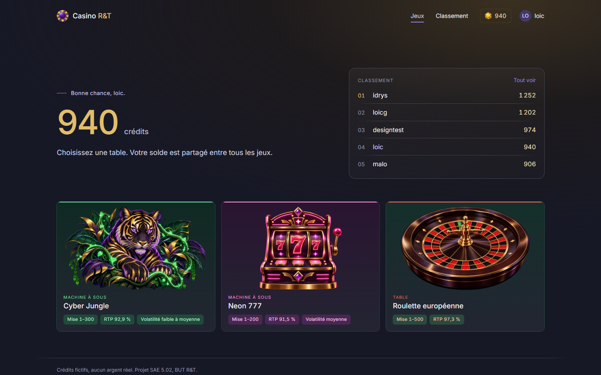
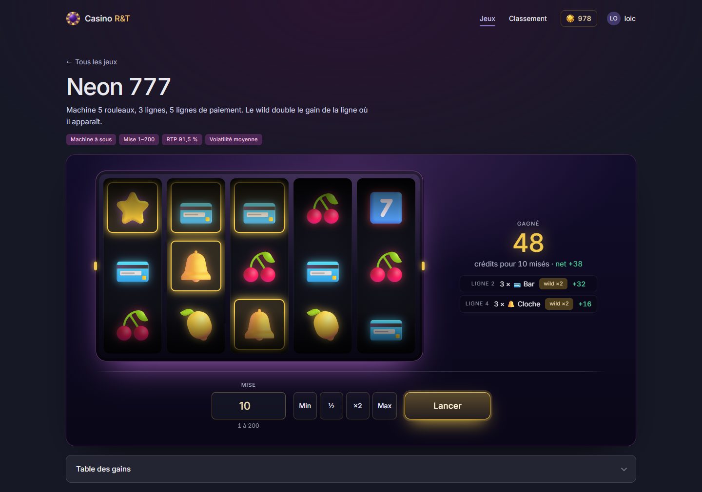
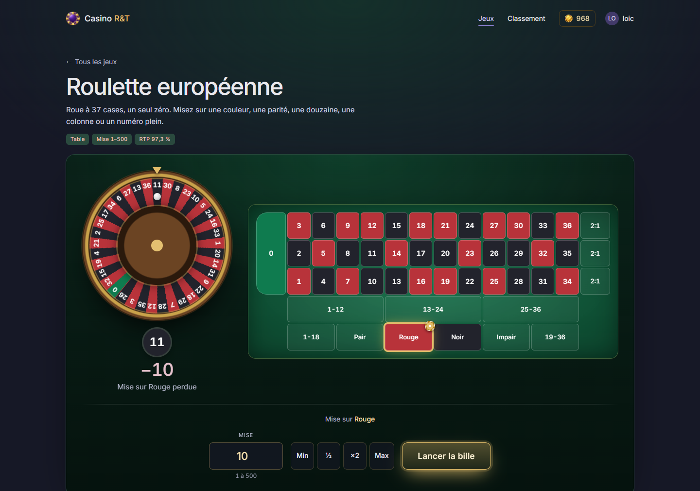
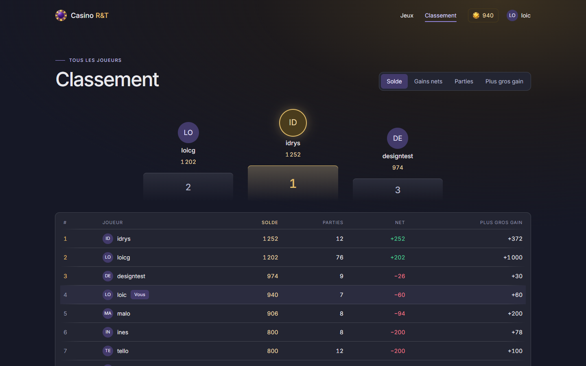

# Casino R&T

Casino web multijoueur avec des crédits fictifs. Chacun crée son compte, reçoit
1000 crédits et joue pendant que les autres sont connectés. Aucun argent réel.

Projet SAE 5.02, BUT Réseaux & Télécommunications.

<!-- screenshot: page d'accueil -->


## Ce qu'il y a dedans

Inscription et connexion, solde par joueur, deux jeux jouables de bout en bout,
historique des parties, statistiques et classement entre joueurs.

Le service tourne sur un NAS et est accessible depuis Internet en HTTPS.

### Machine à sous

Deux machines, chacune avec ses propres symboles, ses wilds, ses scatters et sa
table de gains. Le moteur est générique : une machine se décrit en données, pas
en code, donc en ajouter une ne demande pas de toucher au reste.

Taux de retour mesurés par simulation : 91.5% et 92.9%.

<!-- screenshot: machine à sous -->


### Roulette

Roulette européenne, 37 cases avec un seul zéro. Rouge/noir, pair/impair,
manque/passe, douzaines, colonnes et plein. Taux de retour 97.3%.

<!-- screenshot: roulette -->


### Historique et classement

Chaque partie est enregistrée. Le joueur retrouve son historique, ses stats par
jeu et sa place au classement.

<!-- screenshot: stats / classement -->


## Stack

| | |
|---|---|
| Interface | Rendu serveur en Go avec templ, htmx, CSS |
| API | Go 1.25, Gin |
| Base | PostgreSQL 16, GORM |
| Déploiement | Docker Compose sur NAS |
| Accès Internet | nginx + Cloudflare Tunnel, HTTPS |

## Comment ça marche

Le navigateur parle à nginx, qui relaie tout vers le serveur Go. Ce serveur
rend les pages HTML et expose aussi une API JSON sous `/api`. Il est le seul à
toucher à PostgreSQL.

L'interface n'a pas de JavaScript maison. Les formulaires marchent tels quels,
et htmx remplace seulement la zone de jeu après une mise, sans recharger la
page. Les rouleaux et la roue sont animés en CSS à partir du vrai tirage : le
serveur place la bande de chaque rouleau et calcule l'angle d'arrêt de la roue. cloudflared ouvre un tunnel
sortant vers Cloudflare, donc aucun port n'est ouvert sur la box et
l'administration du NAS reste injoignable depuis l'extérieur.

Le point délicat c'est le solde. Plusieurs joueurs misent en même temps, et un
même joueur peut envoyer plusieurs mises coup sur coup. Une mise se fait donc
dans une transaction qui verrouille la ligne du joueur : on vérifie le solde,
on tire le résultat, on écrit le nouveau solde et la partie d'un bloc. Sans ça
deux mises simultanées lisent le même solde et une des deux disparaît.

Les mots de passe sont hachés en Argon2id, les sessions sont des jetons
aléatoires stockés en base et posés dans un cookie `HttpOnly`.

## Démarrage

```bash
cd deploy
cp .env.example .env
docker compose up -d --build
```

Le détail est dans [docs/install.md](docs/install.md), et le contrat d'API pour
le front dans [docs/api.md](docs/api.md).

## Équipe

| | |
|---|---|
| Tello | Documentation et suivi du projet |
| Idrys | Back-end, base de données, hébergement |
| Loïc | Interface et intégration |

## Licence

MIT, voir [LICENSE](LICENSE).
